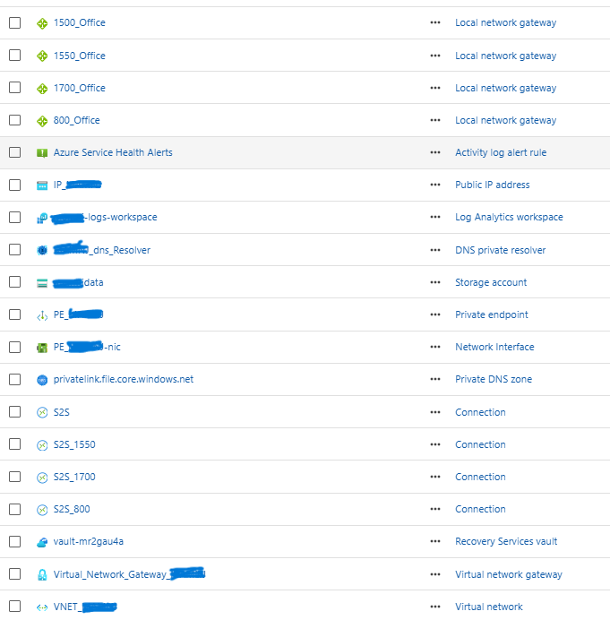

# SharePoint to Azure Files Migration – Multi-Office Infrastructure

## Introduction

The goal of this project is to design and implement a secure, centralized file storage solution in Microsoft Azure by migrating departmental files from SharePoint to Azure Files.

The organization has four physical office locations:

- Office 1500
- Office 1550
- Office 800
- Office 1700

Each office needs secure access to its departmental file shares. To accomplish this, I designed an Azure Storage Account with separate Azure File Shares for each department, connected the four offices to Azure through Site-to-Site VPN connections, and planned a Point-to-Site VPN solution for remote employees working from home or job sites.

The solution also includes:

- Private connectivity using Azure VPN Gateway.
- Private Endpoint for Azure Files.
- Private DNS integration.
- Azure Recovery Services Vault for backup and recovery.
- Azure Monitor and Log Analytics for monitoring and troubleshooting.
- Azure Service Health alerts for infrastructure notifications.

The objective is to provide employees with reliable access to company files while reducing dependency on SharePoint for traditional departmental file storage.

---

## 1. Azure Infrastructure Diagram

The following screenshot shows the Azure resources deployed for this project.

### "PLEASE NOT THAT I HAVE REPLACE THE COMPANY NAME WITH MHNDAZ FOR PRIVACY PURPOSES"

### Azure Resources

| Resource | Resource Name | Purpose |
|---|---|---|
| Virtual Network | `VNET_MHNDAZ` | Central Azure network |
| Virtual Network Gateway | `Virtual_Network_Gateway_MHNDAZ` | VPN connectivity |
| VPN Connection | `S2S_1500` | Office 1500 connection |
| VPN Connection | `S2S_1550` | Office 1550 connection |
| VPN Connection | `S2S_1700` | Office 1700 connection |
| VPN Connection | `S2S_800` | Office 800 connection |
| Local network gateway | `1500_Office` | Represents the 1500 on-premises network |
| Local network gateway | `1550_Office` | Represents the 1550 on-premises network |
| Local network gateway | `800_Office` | Represents the 800 on-premises network |
| Local network gateway | `1700_Office` | Represents the 1700 on-premises network |
| Public IP | `IP_MHNDAZ` | VPN Gateway public IP |
| Storage Account | `mhndazdata` | Centralized file storage |
| Private Endpoint | `PE_MHNDAZ` | Private storage connectivity |
| Network Interface | `PE_MHNDAZ-nic` | Private Endpoint interface |
| Private DNS Zone | `privatelink.file.core.windows.net` | Private DNS resolution |
| DNS Private Resolver | `MHNDAZ_dns_Resolver` | DNS forwarding and resolution |
| Recovery Services Vault | `vault-mr2gau4a` | Backup and recovery |
| Log Analytics Workspace | `mhndaz-logs-workspace` | Centralized logging |
| Service Health Alert | `Azure Service Health Alerts` | Azure service notifications |

---

## 2. Azure Storage Account and File Shares

I created an Azure Storage Account named `mhndazdata` to host the organization's departmental file shares.

Azure Files provides a centralized storage platform that can be accessed using the SMB protocol.

Each department will have its own dedicated file share to organize data and manage access permissions.

### Proposed Departmental File Shares

Now we are going to create a file share in the storage account for each departments, in our case here we have 5 and each one needs a specific amount of storage, for the IOPS and Throughput i m using the default values but we can adjust that depending on the needs.

the following is the screenshots of our file shares

### Storage Security

The following security measures will be implemented:

- Enable encryption at rest.
- Configure Microsoft Entra ID-based authentication where supported.
- Configure role-based access control (RBAC).
- Apply share-level and NTFS permissions.
- Restrict public network access.
- Use Private Endpoint connectivity.
- Enable soft delete where appropriate.

The goal is to ensure employees can access only the files and folders authorized for their department.

---

## 3. Networking and VPN Configuration

Networking is one of the most important components of this project because employees at all four offices must securely access Azure Files.

### 3.1 Virtual Network

I created a central Azure Virtual Network named:

`VNET_MHNDAZ`

This virtual network provides the foundation for the Azure infrastructure and hosts the networking components required for private connectivity.

### 3.2 Site-to-Site VPN

I designed a Site-to-Site VPN architecture to connect four physical offices to Azure.

| Office | VPN Connection |
|---|---|
| Office 1500 | `S2S_1500` |
| Office 1550 | `S2S_1550` |
| Office 800 | `S2S_800` |
| Office 1700 | `S2S_1700` |

Each office requires a VPN-capable firewall or router with a public IP address and its own local network configuration.

The Site-to-Site VPN tunnels provide encrypted communication between the office networks and Azure.

Employees connected to their office networks will be able to access centralized Azure file shares without requiring a separate VPN connection on their individual computers.

### 3.3 Point-to-Site VPN

In addition to the Site-to-Site connections, the project includes a Point-to-Site VPN solution.

This will allow employees working remotely to connect securely to the Azure Virtual Network.

Examples include:

- Employees working from home.
- Employees working at customer locations.
- Employees traveling between offices.
- IT administrators performing remote maintenance.

The Point-to-Site VPN will use certificate-based or Microsoft Entra ID authentication, depending on the selected VPN configuration.

### 3.4 Private Endpoint

I created a Private Endpoint named:

`PE_MHNDAZ`

The Private Endpoint provides private connectivity between the Azure Virtual Network and the Azure Storage Account.

This allows Azure Files traffic to use a private IP address instead of relying on its public endpoint.

The associated network interface is:

`PE_MHNDAZ-nic`

Public network access should be restricted after private connectivity has been tested.

### 3.5 Private DNS

I created the Private DNS Zone:

`privatelink.file.core.windows.net`

This zone allows internal clients to resolve the Azure Files endpoint to its private IP address.

The DNS Private Resolver resource:

`MHNDAZ_dns_Resolver`

supports DNS resolution and forwarding between the office networks and Azure.

DNS forwarding must be configured so that on-premises DNS servers can resolve Azure Files private endpoint records.

Establishing a VPN connection alone does not guarantee that clients can resolve the private storage endpoint.

---

## 4. SharePoint to Azure Files Migration

A major part of this project is migrating existing departmental documents from SharePoint Online to Azure Files.

The migration will move the organization's existing documents into the appropriate Azure File Shares.

### Migration Process

#### Step 1 – Inventory Existing SharePoint Data

Before starting the migration, I will identify:

- Existing SharePoint sites.
- Document libraries.
- Departmental folders.
- File sizes and total storage requirements.
- Existing user permissions.
- Files that are no longer required.

#### Step 2 – Prepare Azure File Shares

Create the departmental file shares inside the `mhndazdata` Storage Account.

Create the folder structure to match the existing departmental organization.

#### Step 3 – Export SharePoint Documents

Export or download the documents from SharePoint Online using an appropriate migration process.

Microsoft Graph API or an approved migration tool can be used to retrieve document library content.

#### Step 4 – Transfer Documents to Azure Files

Transfer the exported documents into their corresponding Azure File Shares.

The following tools can be used:

- Azure Storage Explorer
- AzCopy
- PowerShell automation
- Microsoft Graph API

#### Step 5 – Reconfigure Permissions

SharePoint permissions do not automatically become Azure Files permissions.

After migration, configure the appropriate Azure Files authentication, share-level permissions, and NTFS permissions to ensure that each department has access to its authorized folders.

#### Step 6 – Validate the Migration

Verify that:

- All expected documents have migrated.
- Folder structures are correct.
- File sizes and counts match.
- Users can access their departmental shares.
- Permissions are working correctly.
- Files can be opened and modified.

#### Step 7 – Final Cutover

Once the migration has been validated, communicate the transition to employees and make Azure Files the primary location for departmental file storage.

The original SharePoint data should remain available during the validation and rollback period until the migration has been formally approved.

---

## 5. Backup and Disaster Recovery

Data protection is another important requirement of this project.

I created an Azure Recovery Services Vault named:

`vault-mr2gau4a`

The vault will be used to protect the Azure File Shares through Azure Backup.

### Backup Schedule

The backup design calls for four backups per day.

| Backup | Scheduled Time |
|---|---|
| Backup 1 | 12:00 AM |
| Backup 2 | 6:00 AM |
| Backup 3 | 12:00 PM |
| Backup 4 | 6:00 PM |

The actual backup schedule and retention settings will be configured using a supported Azure Backup policy.

The objective is to minimize data loss and provide multiple recovery points throughout the day.

### Recovery Options

In the event of accidental deletion, file corruption, or data loss, administrators will be able to restore protected data using Azure Backup recovery points.

The recovery process will include:

1. Identify the affected file share.
2. Locate the appropriate recovery point.
3. Select the required files or folders where supported.
4. Restore the data.
5. Verify that the restored files are accessible.

Backup jobs will be monitored to ensure failures are identified and resolved.

---

## 6. Monitoring and Logging

To monitor the Azure environment, I created a Log Analytics Workspace:

`mhndaz-logs-workspace`

This workspace will provide centralized logging and monitoring for supported Azure resources.

The monitoring solution will help administrators identify:

- VPN connection issues.
- Storage availability problems.
- Backup failures.
- Azure resource health events.
- Network connectivity issues.
- Relevant diagnostic events.

I also created an Azure Service Health Alert named:

`Azure Service Health Alerts`

This alert will notify administrators when Azure service incidents or planned maintenance events may affect the environment.

Monitoring and alerting will help reduce downtime and improve troubleshooting.

---

## 7. Testing and Validation

Before considering the project complete, I will perform the following tests:

| Test | Expected Result |
|---|---|
| Office 1500 VPN | Successfully connects to Azure |
| Office 1550 VPN | Successfully connects to Azure |
| Office 800 VPN | Successfully connects to Azure |
| Office 1700 VPN | Successfully connects to Azure |
| Point-to-Site VPN | Remote users can connect |
| Private DNS | Resolves storage endpoint to private IP |
| Private Endpoint | Storage access uses private connectivity |
| File Share Access | Authorized users can access departmental folders |
| File Permissions | Unauthorized users are denied access |
| SharePoint Migration | Documents and folder structures are validated |
| Azure Backup | Four scheduled recovery points are created daily |
| Restore Test | Files can be successfully restored |
| Log Analytics | Relevant logs and diagnostics are available |

---

## 8. Conclusion

This project demonstrates how an organization can transition from SharePoint-based departmental document storage to a centralized Azure Files solution.

By implementing Azure Storage Accounts, Site-to-Site VPN connections, Point-to-Site VPN access, Private Endpoints, Private DNS, Azure Backup, and centralized monitoring, the organization gains a secure and scalable file storage environment.

The solution connects four physical office locations to Azure while also providing remote employees with a secure access method.

The SharePoint migration component will move existing departmental documents into Azure Files while preserving the required folder organization and re-establishing appropriate permissions.

The final result is a centralized cloud-based file storage solution that improves accessibility, simplifies infrastructure management, and provides a foundation for business continuity and disaster recovery.

---

## Technologies Used

- Microsoft Azure
- Azure Storage Account
- Azure Files
- Azure Virtual Network
- Azure VPN Gateway
- Site-to-Site VPN
- Point-to-Site VPN
- Azure Private Endpoint
- Azure Private DNS
- Azure DNS Private Resolver
- Azure Recovery Services Vault
- Azure Backup
- Azure Log Analytics
- Azure Monitor
- Microsoft SharePoint Online
- Microsoft Graph API
- Azure Storage Explorer
- AzCopy
- PowerShell

---

## Project Status

Azure infrastructure resources have been deployed as shown in the Azure Portal screenshot.

The following items require configuration, validation, or completion:

- Departmental Azure File Shares.
- SharePoint document migration.
- Point-to-Site VPN configuration.
- VPN connectivity testing.
- Private DNS validation.
- Backup policy configuration.
- Restore testing.
- End-to-end user access testing.

---

## Microsoft Documentation

- [Azure Files Documentation](https://learn.microsoft.com/azure/storage/files/)
- [Azure Files Networking](https://learn.microsoft.com/azure/storage/files/storage-files-networking-overview)
- [Azure Private Endpoint](https://learn.microsoft.com/azure/storage/files/storage-files-networking-endpoints)
- [Azure Files DNS](https://learn.microsoft.com/azure/storage/files/storage-files-networking-dns)
- [Azure Files Backup](https://learn.microsoft.com/azure/backup/backup-afs)
- [Microsoft Graph API](https://learn.microsoft.com/graph/overview)
- [AzCopy Documentation](https://learn.microsoft.com/azure/storage/common/storage-use-azcopy-v10)
